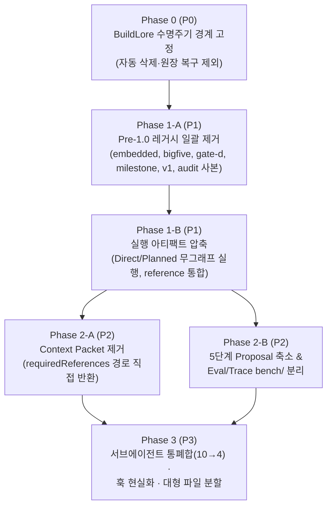

# P2A 하네스 경량화 및 1.0 전이 개발 계획

작성일: 2026-11-26<br>
상태: 개발 기준 계획 (우선순위별 단계적 전이)<br>
검토 기준: Plan2Agent `v0.9.0` (`8d5f9dd`)<br>
문서 홈: [Plan2Agent Docs](README.md) · 관련 설계: [자율 개발 개선안](gate-driven-adaptive-execution-proposal.md) · [개발비서·지식 인계 설계안](development-assistant-and-knowledge-lifecycle-proposal.md)

## [한눈에]

`v0.9.0`까지의 개선으로 프롬프트(`SKILL.md`, `references/*.md` 총 793줄)는 얇아졌으나, 상태 전이·검증·호환·계측 복잡도가 CLI 스크립트(64개 · 68,901줄)와 JSON 스키마(36개 · 7,776줄)로 누적되었다. `1.0.0` 진입 전에 **핵심 안전 경계(인간 기획 승인, 실행된 검증 증거, 단일 `p2a next` 라우팅)는 보존**하면서, 과도한 파생 산출물·컨텍스트 패킷 프로토콜·미구현 분산 삭제 설계·레거시 호환 계층·주변부 하위 시스템을 우선순위(`P0 → P1 → P2 → P3`)대로 감량한다.

```text
P0 경계 고정 (분산 삭제·원장 재초기화 중단)
  → P1-A Pre-1.0 레거시 호환 일괄 제거
  → P1-B 실행 아티팩트·참조 사이드카 압축
  → P2-A Context Packet 프로토콜 제거·경로 직접 안내 전환
  → P2-B 5단계 Proposal 축소 및 연구용 Eval/Trace 분리
  → P3 서브에이전트 통폐합(10→4)·훅 현실화·거대 스크립트 분할
```

---

## 1. 목적과 전이 원칙

### 1.1 해결하려는 문제

1. **다중 파생 JSON과 해시 체인 중복**: 요구사항 하나가 실행되기까지 `entry` → `reference-bundle(3종)` → `intake` → `decisions.jsonl + approval_audit` → `spec` → `current-spec` → `current-development-contract` → `synthetic task-graph` → `run + envelope store`까지 최대 6~7단계를 거치며 스키마·마이그레이션 부담을 키운다.
2. **컨텍스트 전달 계층의 역전**: 전체 793줄에 불과한 레퍼런스 마크다운을 조건부 전달하기 위해 수천 줄 규모의 `context show` 패킷·바인딩·감사 시스템을 운영하고 있다.
3. **로컬 도구를 넘어서는 수명주기·주변부 팽창**: 제품-지식저장소 간 참조 전환 후 원본 자동 삭제/원장 복구 제안, 5단계 proposal 파이프라인, 연구용 수동 주석 eval 엔진, 독자 트랜잭션 스킬 매니저가 본체 복잡도를 압도한다.
4. **Pre-1.0 레거시 누적**: 이미 폐기된 기능(`team-bigfive`, `gate-d-review`, `milestone-review`, `embedded` 스크립트 복사, `v1` 응답/실행 스키마)의 reader·validator·fixture가 그대로 남아 변경 비용을 증폭시킨다.

### 1.2 반드시 보존할 핵심 안전 경계 (불변식)

경량화 과정에서 아래 다섯 가지 경계는 약화하거나 통합 삭제하지 않는다.

- **제품 의미의 명시적 인간 승인**: 범위(Gate A), 되돌리기 어려운 장기 원칙(조건부 Gate ②), 제품/구현 명세(Gate B)는 사용자의 실제 발화(`quote`)가 기록되어야 통과한다.
- **실행된 명령 기반 검증**: 실행되지 않은 검사를 통과로 기록하지 않으며, 코드 변경과 문서/메타데이터 변경의 revision별 검증 의무를 구분해 fail-closed로 판정한다.
- **단일 상태 결정 권위(`p2a next`)**: 에이전트가 프로젝트 상태를 임의로 추론하지 않고 CLI가 계산한 다음 행동(`command`), 진행 브리핑(`briefing`), 상태 지침(`agentGuidance`)을 따른다.
- **승인 범위 내 자율 구현과 명확한 중단 조건**: 일반 코드·테스트·UI drift는 에이전트가 같은 실행 안에서 자율 수정하고, 제품 의미·수용 기준·헌법·외부 권한 변경이 필요할 때만 멈춘다.
- **로컬 우선·무인 외부 부작용 금지**: 원격 push, 이슈 게시, 배포, 유료 호출은 명시적 사용자 승인 없이는 실행하지 않는다.

### 1.3 정량 감량 목표 (`v0.9.0` → `v1.0.0` 전이 완료 기준)

| 영역 | 현재 (`v0.9.0`) | 전이 후 목표 | 주요 수단 |
| --- | ---: | ---: | --- |
| 런타임·CLI 스크립트 | 64개 · ~68.9k줄 | 38개 내외 · ~38k줄 이하 | 레거시·패킷·5단계 proposal 제거, eval/trace 분리, 공통 파서 |
| 배포 JSON 스키마 | 36개 · ~7.8k줄 | 17개 내외 · ~3.5k줄 이하 | 폐기 스키마, 패킷/사이드카/proposal/eval 스키마 정리 |
| 서브에이전트 파일 (정본+3미러) | 10역할 · 40파일 | 4역할 · 16파일 | 역할 통폐합 및 미사용 큐레이터/레거시 그래프 작성자 제거 |
| 스킬 구성 | 7개 | 6개 | `p2a-task-breakdown` 호환 엔트리 제거 |
| Direct 실행 산출물 단계 | `intake → spec → current-spec → contract → synthetic graph → run` | `intake → spec → contract → run` | 가짜 `task-graph.json` 및 `approval_audit` 이중 사본 제거 |

---

## 2. 우선순위별 전이 범위와 상세 계획

### Phase 0 (P0): BuildLore 지식 수명주기 경계 고정 *(완료 — 2026-11-26)*

#### 현재 문제

`docs/development-assistant-and-knowledge-lifecycle-proposal.md`의 미구현 범위(§5.4~§7)는 완료 작업 문서를 삭제하기 위해 제품 저장소와 BuildLore 저장소 간 참조 전환 확인, 지연 인계(A/B 순서 역전) 기준 병합, 삭제 후 `baseline.restored` 시스템 이벤트로 새 로컬 원장 체인을 여는 분산 일관성 프로토콜을 예정하고 있다. 로컬 개발 비서 도구에서 두 Git 저장소 간 비원자적 상태를 동기화·복구하는 비용과 결함 위험이 실익보다 훨씬 크다.

#### 전이 방향

1. **BuildLore 연동 경계를 현행 2가지 역할로 동결한다.**
   - 개발 중: 설정된 프로젝트에서 제한된 읽기 전용 조회(`memory`, `lookup`)와 진행/방향 조언에 활용한다.
   - 개발 완료 후: 명시적인 단방향 스냅샷 추출(`p2a knowledge capture`)과 보존 객체 전달(`p2a buildlore handoff import/list/read/verify`)까지만 지원한다.
2. **다음 미구현 항목을 공식 비목표(제외)로 전환한다.**
   - 보존 source 전환 확인 후 로컬 Gate/iteration 정본 문서를 자동 삭제하는 정리기
   - 삭제된 작업 폴더 없이 외부 지식저장소만으로 다음 반복을 열거나 `baseline.restored`로 새 `decisions.jsonl` 체인을 초기화하는 복구 경로
   - 지연 인계의 전역 완료 기준 병합 프로토콜
3. **로컬 상태 책임을 단순 고정한다.**
   - 프로젝트의 현재 개발 기준은 항상 로컬 `.plan2agent/artifacts/<project_id>/`가 소유한다.
   - 로컬 디스크 정리는 용량이 큰 실행 기록을 다루는 기존 `runTracking.persistence = active_only` 및 `p2a runs gc`만 담당한다.
   - `p2a knowledge capture` 출력의 `cleanupEligible`은 삭제 자동화 약속으로 확장하지 않고 제거하거나 고정 안내 필드로 축소한다.

#### 주요 수정 파일

- `docs/development-assistant-and-knowledge-lifecycle-proposal.md`
- `docs/cli-reference.md`
- `README.md`, `README.ko-KR.md`
- `scripts/p2a_knowledge_handoff.mjs`
- `tests/knowledge-handoff.test.mjs`

#### 완료 조건

- 설계 문서와 CLI 안내에서 자동 아티팩트 삭제·분산 원장 재초기화 계획이 비목표로 명확히 정리된다.
- BuildLore 미설치·연결 실패 상태에서도 로컬 아티팩트만으로 모든 반복 개발(`open`, `close`, `abandon`, `maintenance`)이 완결된다.
- 기존 읽기 전용 조회(`memory`, `lookup`)와 단방향 `knowledge capture` / `handoff` 테스트가 유지된다.

---

### Phase 1-A (P1): Pre-1.0 레거시 호환 계층 일괄 제거

#### 현재 문제

`1.0` 이전 버전임에도 초기 실험 기능과 구버전 스키마·런타임 복사 모드가 모두 유지되어 `p2a_handoff.mjs`(5,656줄), `validate_artifacts.mjs`(6,847줄), `run_fixtures.mjs`(9,246줄)의 상당 부분을 차지한다. 아티팩트 구조를 압축하기 전에 죽은 가지부터 먼저 제거해야 후속 변경의 영향 범위가 줄어든다.

#### 전이 방향

1. **`team-bigfive` 외부 하네스 이식 코드 제거**
   - `p2a handoff`의 `--include-team-bigfive`, `--team-bigfive-source`, `--team-bigfive-targets` 옵션과 관련 스킬/코디네이터 생성 로직을 전부 삭제한다.
2. **Writer가 사라진 폐기 스키마·검증기·픽스처 제거**
   - `schemas/milestone-review.schema.json`, `schemas/review.schema.json`(`gate-d-review`)을 제거한다.
   - `validate_artifacts.mjs`, `p2a_handoff.mjs`, `p2a_handoff_portability.mjs`, `p2a_eval.mjs`, `p2a_run_paths.mjs`, `p2a_tasks.mjs`에서 `milestone-reviews/` 및 `gate-d-review/` 처리 분기를 제거한다.
3. **Embedded 런타임 복사 방식 제거 (패키지 런타임 단일화)**
   - 타겟 프로젝트의 `.plan2agent/scripts/` 및 `.plan2agent/schemas/`에 런타임 사본 80여 개를 복사·갱신하던 `embedded` 모드를 제거한다.
   - `p2a init`, `update`, `upgrade`, `handoff`는 프로젝트 상태(`.plan2agent/project.config.json`, `manifest.json`)와 선택된 프로바이더 자산(`.agents`, `.claude`, `.codex`, `.gemini`)만 관리한다.
   - 기존 embedded 설치 프로젝트를 위해 `p2a upgrade --target . --apply --prune`에 한해 구형 `.plan2agent/scripts`·`schemas` 관리 파일을 정리하는 단방향 전환만 남긴다.
4. **Flat Root 전용 태스크 분해 호환 엔트리 제거**
   - `.agents/skills/p2a-task-breakdown/` 스킬과 `.agents/agents/p2a-task-graph.md` 에이전트(및 프로바이더 미러)를 삭제하고 `p2a-task-author` 단일 경로로 통합한다.
5. **버전 이중화 및 승인 사본(`approval_audit`) 이중 기록 정리**
   - `p2a next` 출력 계약을 `p2a.next.v2` 단일 기본값으로 통합하고 `p2a.next.v1` 응답 생성 및 스키마 분기를 제거한다(`--contract v2` 플래그는 호환 no-op으로 허용).
   - `decisions.jsonl`을 유일한 승인·철회 정본으로 확정한다. `intake.json`, `spec.json`, `constitution.json` 내부에 `approval_audit` 사본을 중복 기록하거나 원장 부재 시 사본으로 폴백하던 경로를 제거한다(기존 원장 없는 프로젝트용 1회성 `p2a decisions migrate-legacy-audits` 명령만 선택 제공하거나 `1.0` 전환 가이드로 안내).
   - `intake.schema.json`의 레거시 불투명 `interview` 허용 분기와 `p2a.run.v1` / inline `executionEnvelope` 구형 분기를 정리한다.

#### 주요 수정·제거 파일

- 제거 스키마: `schemas/milestone-review.schema.json`, `schemas/review.schema.json`
- 제거 자산: `.agents/skills/p2a-task-breakdown/`, `.agents/agents/p2a-task-graph.md` (+ `.claude`, `.codex`, `.gemini` 미러)
- 수정 스크립트: `scripts/p2a_handoff.mjs`, `scripts/p2a_handoff_portability.mjs`, `scripts/p2a_paths.mjs`, `scripts/p2a_upgrade.mjs`, `scripts/p2a_next_service.mjs`, `scripts/p2a_decisions.mjs`, `scripts/p2a_decision_ledger.mjs`, `scripts/validate_artifacts.mjs`, `scripts/sync_cli_assets.mjs`
- 수정 스키마: `schemas/next.schema.json`, `schemas/intake.schema.json`, `schemas/spec.schema.json`, `schemas/constitution.schema.json`, `schemas/run.schema.json`
- 수정/제거 테스트·픽스처: `tests/milestone-review.test.mjs`(제거), `fixtures/_negative/review-blocked/`(제거), `fixtures/_negative/missing-approval-audit/`, `scripts/run_fixtures.mjs`

#### 완료 조건

- 코드베이스 내 `team-bigfive`, `gate-d-review`, `milestone-review`, `p2a-task-breakdown`, `p2a-task-graph`, `P2A_PATHS.embedded` 실행 분기가 0건이 된다.
- `p2a next`가 플래그 없이 단일 현행 계약(`v2` 구조)을 반환한다.
- 모든 승인 검증이 `decisions.jsonl` 단일 원장만으로 동작하며 이중 사본 불일치 오류가 발생하지 않는다.

---

### Phase 1-B (P1): 실행 아티팩트 및 참조 사이드카 단계 압축

#### 현재 문제

1. `Direct`와 `Planned` 실행 모드는 태스크 그래프가 필요 없는데도 기존 오케스트레이션 실행기와의 호환을 위해 `p2a execute prepare`가 `gate-c-task-graph/task-graph.json`에 가짜 단일 항목(`syntheticWorkItem`)을 생성한다.
2. 진입 문서의 참조 자료를 다루기 위해 `p2a-reference-bundle.json` 외에 바이트 전체 스냅샷 디렉터리(`reference-sources/`)와 `reference-bundle-snapshot.json`, `reference-bundle-usage.json` 사이드카를 별도로 강제한다.
3. 활성 반복에서 `spec.json`, `current-spec.json`, `current-development-contract.json` 세 파일이 유사한 명세·제약 데이터를 중복 보유한다.

#### 전이 방향

1. **`Direct` / `Planned`에서 가짜 `task-graph.json` 생성 제거**
   - `task-graph.json`(`schemas/task-graph.schema.json`)은 다중 작업·의존성·병렬 소유권이 실제로 필요한 **`Orchestrated` 모드와 `maintenance` 큐 전용**으로 한정한다.
   - `current-development-contract.json`에 실행 준비 정보(`execution: { mode: 'direct' | 'planned' | 'orchestrated', selectionRationale, milestones?: [...] }`)를 직접 기록한다.
   - `Direct`와 `Planned`에서는 `p2a execute prepare`가 가짜 `task-graph.json`을 만들지 않고 `current-development-contract.json`을 갱신하며, `p2a execute start`는 계약에서 직접 단일 목표 실행(`objective` 단위 run)을 시작한다.
2. **참조 번들 3단계 사이드카를 표준 `evidence[]`로 통합**
   - 선택적 입력 매니페스트(`p2a-reference-bundle.json`)가 있으면 경로·종류만 확인하고, 에이전트가 실제로 열람해 판단 근거로 삼은 파일만 `intake.json` / `spec.json`의 `evidence[]`(`LOCAL-n`, 상대 경로 + SHA-256 + `used_for`)에 직접 기록한다.
   - 원본 바이트 통째 복제(`gate-a-intake/reference-sources/`), `reference-bundle-snapshot.json`, `reference-bundle-usage.json` 및 `p2a reference snapshot` 명령을 제거한다.
3. **명세 합성 뷰와 실행 계약의 책임 분리 고정**
   - `iterations/<id>/gate-b-spec/spec.json`: 해당 반복에서 승인된 기획·구현 명세 원본.
   - `current-development-contract.json`: 실행(`next`, `execute`, `runs`)이 읽는 **유일한 런타임 실행 계약**.
   - `current-spec.json`: 반복 상태 포인터와 다음 반복 `open` 시 baseline 파생을 위한 효과 명세(effective spec) 역할만 유지하되, 일반 실행 중(`start`, `verify`, `checkpoint`, `finish`)에는 중복 로드·교차 검증하지 않는다.

#### 주요 수정·제거 파일

- 제거 파일: `scripts/p2a_reference.mjs`, `schemas/reference-bundle-snapshot.schema.json`, `schemas/reference-bundle-usage.schema.json`
- 수정 스키마: `schemas/current-development-contract.schema.json`, `schemas/task-graph.schema.json`, `schemas/run.schema.json`, `schemas/intake.schema.json`, `schemas/spec.schema.json`
- 수정 스크립트: `scripts/p2a_execute.mjs`, `scripts/p2a_runs.mjs`, `scripts/p2a_tasks.mjs`, `scripts/p2a_iteration.mjs`, `scripts/p2a_iteration_state.mjs`, `scripts/p2a_next_service.mjs`, `scripts/validate_artifacts.mjs`
- 수정 스킬/레퍼런스: `.agents/skills/p2a-harness/`, `.agents/skills/p2a-spec/`, `.agents/skills/p2a-dev-execution/` (+ 미러 동기화)

#### 완료 조건

- `Direct` 및 `Planned` 실행 시 `gate-c-task-graph/` 디렉터리 없이 `prepare → start → (checkpoint) → verify → finish → close` 전체 수명주기가 통과한다.
- `Orchestrated` 모드와 `maintenance` 작업은 기존 dependency-aware `task-graph.json`으로 동일하게 동작한다.
- 참조 문서가 있는 프로젝트에서 별도 바이트 복사 폴더와 snapshot/usage 사이드카 없이 `LOCAL-n` 해시 기록만으로 Gate A/B 검증이 통과한다.

---

### Phase 2-A (P2): Context Packet 프로토콜 제거 및 경량 참조 라우팅 전환

#### 현재 문제

레퍼런스 문서 전체가 21개(총 793줄)로 충분히 작아졌음에도, 이를 감싸기 위해 `p2a context show`, `p2a_continuations.mjs`, `p2a_context_packet.mjs`, `p2a_context_audit.mjs`(1,444줄), `p2a doctor --context`, 스키마 3종과 `after_command_success` 바인딩 규칙이 유지되고 있다. 에이전트가 추가 CLI 호출과 JSON/패킷 파싱에 쓰는 턴·인지 비용이 마크다운 파일을 직접 읽는 비용보다 크다.

#### 전이 방향

1. **런타임 패킷 조립 CLI(`p2a context show`)와 `continuation` 바인딩 프로토콜을 제거한다.**
2. **필요한 레퍼런스 경로는 기존 명령 출력에서 직접 안내한다.**
   - `p2a next` JSON 응답과 `p2a execute start|resume` 결과에 현재 단계·모드·활성 정책(`visual`, `acceptance`, `monitor`, `buildlore`, `closeout`)에 해당하는 `requiredReferences: string[]`(1~3개 상대 경로)만 포함한다.
   - 에이전트는 안내된 레퍼런스 파일을 기본 파일 읽기 도구로 직접 열람한다(`Direct`, `Planned`, `Orchestrated` 모두 동일한 방식 사용).
3. **정적 라우팅 검증은 경량 패리티 검사로 축소한다.**
   - `SKILL.md`가 참조하는 파일의 실제 존재 여부와 프로바이더 미러 일치 여부는 `scripts/check_cli_parity.mjs`에서 단순 파일 검사로 확인하고, 별도의 `p2a_context_audit.mjs`와 `p2a doctor --context`는 제거한다.

#### 주요 수정·제거 파일

- 제거 스크립트: `scripts/p2a_context.mjs`, `scripts/p2a_context_packet.mjs`, `scripts/p2a_context_audit.mjs`, `scripts/p2a_continuations.mjs`, `scripts/p2a_context_routes.mjs`
- 제거 파일/스키마: `.agents/context-routes.json`, `schemas/context-packet.schema.json`, `schemas/context-routes.schema.json`, `schemas/context-audit.schema.json`
- 수정 스크립트: `scripts/p2a.mjs`, `scripts/p2a_next_service.mjs`, `scripts/p2a_execute.mjs`, `scripts/p2a_doctor.mjs`, `scripts/check_cli_parity.mjs`, `scripts/p2a_tool_manifest.mjs`
- 수정 스킬: `.agents/skills/*/SKILL.md` (Progressive reference routing 표를 간결한 조건 목록으로 유지하고 `p2a context show` 지침 제거)
- 제거/수정 테스트: `tests/context-packet.test.mjs`, `tests/context-audit.test.mjs`, `tests/context-routes.test.mjs` 제거 및 `tests/next-decision.test.mjs` 보완

#### 완료 조건

- 에이전트 실행 중 `p2a context show` 추가 호출 없이 `next` / `execute`가 반환한 `requiredReferences` 경로만으로 단계별 지침이 로드된다.
- `Direct`, `Planned`, `Orchestrated` 세 모드의 레퍼런스 참조 방식이 하나로 통일된다.
- `check_cli_parity.mjs`가 깨진 레퍼런스 링크와 미러 불일치를 계속 검출한다.

---

### Phase 2-B (P2): 회고/제안(Proposals) 단순화 및 연구용 Eval/Trace 분리

#### 현재 문제

1. 회고 후속 처리를 위해 `mine → review → curate → draft-patch → approve-draft` 5단계 JSON 파이프라인(`p2a_proposals.mjs` 2,079줄, 스키마 5종, `p2a-skill-curator` 에이전트)과 경량 4섹션 회고 마크다운(`docs/retrospective/*.md` + GitHub 이슈 등록)이 중복 존재한다.
2. 하네스 자체 실험용으로 만든 수동 주석 기반 eval 지표(`p2a_eval.mjs` 3,237줄, 스키마 4종)와 내부 트레이스/A-B 스크립트 7개가 사용자 배포 패키지(`scripts/`)에 함께 묶여 있다.
3. 외부 스킬(`p2a skills`)의 모든 변경 작업이 `dry-run` 후 `--expect-plan <sha256>` 복사를 강제해 일반 사용 마찰이 크다.

#### 전이 방향

1. **5단계 Proposal 큐 제거 → 경량 회고 + Maintenance/이슈 직결로 단일화**
   - `p2a proposals`의 `mine`, `list`, `show`, `validate`, `digest`, `review`, `curate`, `draft-patch`, `approve-draft`와 관련 JSON 스키마 5종을 제거한다.
   - 종료 시점(`closeout`)의 회고 흐름은 다음 세 동작만 남긴다:
     - `p2a next`의 자동 회고 신호(`retrospectiveSignals`) 요약 확인
     - 필요 시 4섹션 `docs/retrospective/<project>-<iteration>.md` 작성
     - 로컬 후속 개선은 `p2a iteration maintenance add`로, 업스트림 P2A 개선은 `p2a retrospective issue-preview` / `publish-issue --yes`(기존 `p2a_github_issues.mjs` 재사용)로 직결
2. **내부 평가·트레이스 도구의 저장소 전용(`bench/`) 분리**
   - `p2a_ab_metrics.mjs`, `p2a_agy_tool_trace.mjs`, `p2a_tool_trace.mjs`, `p2a_trace_model.mjs`, `p2a_runtime_eval_core.mjs`, `p2a_runtime_context_fixture.mjs`, `p2a_runtime_performance_gate.mjs`, `p2a_eval.mjs` 및 관련 스키마(`eval-*.schema.json`, `sanitized-tool-trace.schema.json`)를 저장소 루트 `bench/`(비배포 개발 도구)로 이동한다.
   - 사용자 CLI 표면(`p2a --help`)에서 `eval`과 `enhance proposals`를 제거하고, `run.schema.json`에서도 수동 실험 주석 전용 필드(`--implementation-interruption`, `--user-correction`, `--gate-return` 집계 마커)를 제거한다.
3. **외부 스킬(`p2a skills`) 실행 마찰 완화**
   - `p2a-skills.lock.json` 고정, 코어 자산 덮어쓰기 차단, 로컬 수정 파일 보호는 그대로 유지한다.
   - `--apply` 실행 시 `--expect-plan <sha256>`를 필수 요구하지 않도록 기본 흐름을 단순화하고(`--dry-run`은 미리보기 옵션으로 유지, 무인 CI 검증용으로만 선택적 `--expect-plan` 허용), 과도한 저널 복구 상태를 단순 원자적 교체로 축소한다.

#### 주요 수정·이동·제거 파일

- 제거 스키마: `schemas/skill-proposal.schema.json`, `schemas/proposal-review.schema.json`, `schemas/proposal-curation.schema.json`, `schemas/proposal-patch-draft.schema.json`, `schemas/proposal-draft-approval.schema.json`
- `bench/` 이동 대상: `scripts/p2a_eval.mjs`, `scripts/p2a_*trace*.mjs`, `scripts/p2a_runtime_*.mjs`, `scripts/p2a_ab_metrics.mjs`, `schemas/eval-*.schema.json`, `schemas/sanitized-tool-trace.schema.json`, 대응 벤치마크 테스트
- 축소/통합 스크립트: `scripts/p2a_proposals.mjs` 제거 후 `scripts/p2a_github_issues.mjs` 기반 경량 `retrospective` 하위 명령으로 정리, `scripts/p2a_proposal_mining.mjs` 정리, `scripts/p2a_external_skills.mjs` 단순화
- 제거 에이전트: `.agents/agents/p2a-skill-curator.md` (+ 미러)

#### 완료 조건

- npm 패키지 tarball(`npm pack --dry-run`)에 연구용 eval/trace 스크립트와 proposal/eval 스키마가 포함되지 않는다.
- 회고 리포트 작성, 로컬 maintenance 등록, GitHub 이슈 미리보기/발행(`--yes` 필수, 비밀정보 차단, 중복 방지)은 그대로 동작한다.
- `p2a skills add/update/sync/remove`가 해시 수동 복사 없이 한 번의 명시적 실행으로 동작하면서 로컬 수정 파일 덮어쓰기 방지 테스트를 통과한다.

---

### Phase 3 (P3): 서브에이전트 통폐합, 훅 현실화, 거대 스크립트 분할

#### 현재 문제

1. 기본 실행이 대부분 단일 owner `Direct` 모드로 처리됨에도 10종의 세분화된 에이전트 정의(프로바이더 미러 포함 40개 파일)를 상시 유지한다.
2. `.claude/hooks/p2a-confine-workspace.mjs`의 Bash 문자열 정규식 경로 파싱은 쉘 문법 특성상 완전한 차단이 불가능하면서 정상 인자 문자열에 오탐을 낼 수 있다.
3. 핵심 스크립트 몇 개가 4,000~9,200줄의 단일 파일로 비대해져 있고, 모든 스크립트가 수동 `for` 루프 인자 파서를 중복 구현하고 있다.

#### 전이 방향

1. **서브에이전트 10종 → 4종 핵심 역할로 통폐합**
   - `p2a-spec-author`: 제품 명세와 구현 계획 초안 작성 통합(`p2a-implementation-planner` 흡수). 단일 명세 작업에서 불필요한 2단계 서브에이전트 호출을 줄인다.
   - `p2a-visual-designer`: `full + current_iteration` 조건에서의 오프라인 HTML 프로토타입 후보 생성 유지.
   - `p2a-implementer`: `Orchestrated` 병렬 worktree 또는 명시적 컨텍스트 격리 구현 전용 유지.
   - `p2a-reviewer`: 독립 검증이 켜진 경우의 수용 기준·헌법 규칙·시각 계약 비교를 담당하는 통합 읽기 전용 리뷰어(`p2a-acceptance-reviewer`, `p2a-performance-monitor`, `p2a-visual-reviewer`의 공통 프롬프트 계약 통합; 시각 캡처 비교 규칙은 조건부 적용).
   - `P1-A`와 `P2-B`에서 제거된 `p2a-task-graph`, `p2a-skill-curator` 및 Gate C 초안 전용 보조 `p2a-task-author` 에이전트(스킬 `p2a-task-author`가 직접 수행 가능)를 정리해 프로바이더별 에이전트 파일을 4개씩(총 16개)으로 축소한다.
2. **Claude Confinement Hook 역할 현실화**
   - 결정론적인 `Write` / `Edit` 도구의 `realpath` 워크스페이스 경계 차단은 그대로 유지한다.
   - `Bash` 도구 검사는 명백한 루트/홈 파괴 명령(`rm -rf /`, `rm -rf ~` 등) 차단만 남기고, 일반 인터프리터 인자 내 슬래시 문자열을 외부 경로로 추정하던 휴리스틱을 제거한다. 서브프로세스 파일시스템 격리는 프로바이더의 OS 샌드박스 설정이 담당함을 문서와 `doctor` 진단에 명시한다.
3. **공통 CLI 인자 파서 도입 및 대형 스크립트 모듈 분리**
   - Node.js 표준 `node:util`의 `parseArgs`를 감싼 얇은 공통 유틸리티를 `p2a_cli_helpers.mjs`에 추가해 각 CLI의 중복 파서를 치환한다.
   - P1~P2 감량 후 남은 대형 파일을 책임 단위로 분리한다:
     - `validate_artifacts.mjs` → `validators/planning.mjs`, `validators/execution.mjs`, `validators/visual.mjs`
     - `p2a_iteration.mjs` / `p2a_iteration_state.mjs` → 상태 해석, 수명주기 전이(`init/open/close/abandon`), 명세 합성 모듈 분리
     - `run_fixtures.mjs` → 시나리오 묶음별 `tests/fixtures-*.test.mjs`로 분할해 병렬 실행 및 실패 지점 국소화

#### 주요 수정 파일

- `.agents/agents/*.md` 및 `scripts/sync_cli_assets.mjs` → `.claude/agents/`, `.codex/agents/`, `.gemini/agents/` 재생성
- `.claude/hooks/p2a-confine-workspace.mjs`
- `scripts/p2a_cli_helpers.mjs`, `scripts/validate_artifacts.mjs`, `scripts/p2a_iteration.mjs`, `scripts/p2a_iteration_state.mjs`, `scripts/run_fixtures.mjs`
- `docs/harness-spec.md`, `docs/supervised-execution.md`, `docs/cli-reference.md`

#### 완료 조건

- `node scripts/sync_cli_assets.mjs && node scripts/check_cli_parity.mjs` 통과 및 에이전트 미러 파일 수 16개(정본 포함 20개) 달성.
- 단일 스크립트 파일 중 3,000줄을 초과하는 God-file이 0개가 된다.
- `npm run test:all` 실행 시간과 실패 시 원인 추적 단위가 시나리오 파일별로 분리된다.

---

## 3. 전이 순서와 의존성 규칙

작업 간 역류와 대규모 충돌을 막기 위해 반드시 아래 순서를 지킨다. 각 단계는 독립된 PR(또는 커밋 묶음)로 완결하고 테스트를 통과한 뒤 다음 단계로 넘어간다.



1. **`P0` 선행**: 만들지 않기로 한 복잡한 수명주기 범위를 먼저 문서·코드에서 동결해야 `P1`에서 로컬 아티팩트 계약을 단순하게 줄일 수 있다.
2. **`P1-A` → `P1-B` 직렬 수행**: 레거시 스키마·`embedded` 복사·`approval_audit` 폴백을 먼저 걷어내야 `validate_artifacts.mjs`와 `p2a_execute.mjs`에서 `Direct`/`Planned` 무그래프 전환(`P1-B`)을 깨끗하게 구현할 수 있다.
3. **`P2-A`와 `P2-B` 병렬 가능**: 아티팩트 계약이 고정된 뒤에는 컨텍스트 라우팅 단순화(`P2-A`)와 회고/벤치마크 분리(`P2-B`)가 서로 다른 파일 집합을 수정하므로 독립 진행할 수 있다.
4. **`P3` 마감**: 불필요한 기능과 스키마가 모두 빠진 뒤에 에이전트 역할 통합과 대형 파일 모듈 분할을 수행해야 죽은 코드를 옮기는 헛수고를 피할 수 있다.

---

## 4. 기존 프로젝트 호환 및 마이그레이션 방침

`0.9.x → 1.0.0` 전이는 **Pre-1.0 정리 창구**를 활용해 영구적인 호환 분기를 남기지 않는 것을 원칙으로 한다.

| 기존 상태 | 전이 처리 방식 | 런타임 영구 분기 유지 여부 |
| --- | --- | --- |
| 글로벌 `p2a` + 표준 `.plan2agent/` 프로젝트 | `p2a upgrade --target . --apply --prune`으로 제거된 관리 자산·구형 미러 자동 정리 | 유지 안 함 |
| 구형 `.plan2agent/scripts` embedded 설치 프로젝트 | `upgrade --prune`에서 구형 embedded 파일 삭제 후 글로벌 `p2a` 사용 안내 | 유지 안 함 |
| `decisions.jsonl`이 이미 있는 프로젝트 | 추가 작업 없이 그대로 동작 (`approval_audit` 필드는 무시 후 다음 쓰기에서 생략) | 유지 안 함 |
| `decisions.jsonl` 없이 옛 `approval_audit`만 있는 프로젝트 | 전환 시점에 `p2a iteration` / `decide`가 명확한 안내 메시지 출력 (필요 시 1회성 변환 스크립트 제공) | 유지 안 함 |
| 기존 `Direct`/`Planned`의 완료된 synthetic `task-graph.json` | 이미 닫힌(`closed`) 과거 반복 폴더는 재검증하지 않음; 활성 반복만 새 계약 적용 | 유지 안 함 |

---

## 5. 단계별 검증 기준

각 단계 완료마다 아래 명령과 계약을 검증한다.

```bash
# 1. 자산 동기화 및 미러 패리티 검사
node scripts/sync_cli_assets.mjs --check
node scripts/check_cli_parity.mjs

# 2. 코어 회귀 및 패키지 검증
npm test
npm run test:full
npm run test:package

# 3. 배포 표면 확인 (Phase 2-B 이후 필수)
npm pack --dry-run
git diff --check
```

### 필수 인수 시나리오 체크리스트

- [x] **P0**: BuildLore 미설정 상태에서 다회 반복(`init → open → close → abandon → maintenance`)이 외부 지식저장소 의존 없이 완결된다.
- [ ] **P1-A**: `decisions.jsonl` 변조 시 fail-closed로 차단되며, `approval_audit` 사본 없이 Gate A/②/B 승인이 정상 기록·검증된다.
- [ ] **P1-B**: `Direct` 모드 프로젝트에서 `task-graph.json` 파일이 생성되지 않고도 구현·검증·종료가 완료된다.
- [ ] **P1-B**: `Planned` 모드에서 2~5개 체크포인트 순서 강제와 미완료 체크포인트 `finish` 차단이 `current-development-contract.json` 기준으로 동일하게 작동한다.
- [ ] **P1-B**: `Orchestrated` 모드에서 다중 태스크 의존성 및 병렬 worktree 통합 검증이 기존대로 통과한다.
- [ ] **P2-A**: `p2a context show` 없이 `p2a next`와 `p2a execute` 안내 경로만으로 에이전트 실행 흐름이 끊기지 않는다.
- [ ] **P2-B**: 종료 시 회고 마크다운 작성, `maintenance add`, GitHub 이슈 미리보기/등록(`--yes`)이 5단계 proposal 큐 없이 동작한다.
- [ ] **P2-B**: `npm pack --dry-run` 결과에 `bench/`, `docs/`, `tests/`, `fixtures/`가 포함되지 않는다.
- [ ] **P3**: 통합된 4개 서브에이전트 정의가 Claude Code, Codex, Gemini CLI 세 타겟 미러에서 패리티 검사를 통과한다.
