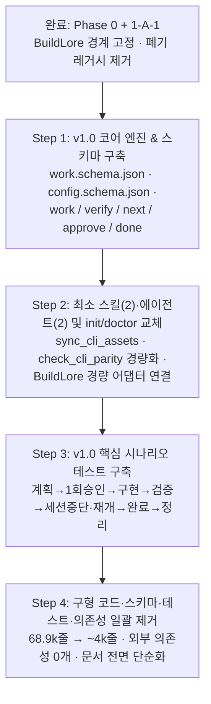

# P2A v1.0 최소 하네스 재설계 및 전이 개발 계획

작성일: 2026-11-26<br>
상태: **구현 완료** (`feat/v1-minimal-harness`, **단일 `work.json` · 1회 통합 확인 · 완료 시 비움/교체 · 최소 코어 + 선택적 BuildLore**)<br>
기준 시점: Plan2Agent `v0.9.0` (`8d5f9dd`) → `v1.0.0` 재편<br>
문서 홈: [Plan2Agent Docs](README.md)

## [한눈에]

Plan2Agent의 본질적 목적을 **"하나의 개발에서 태스크를 관리하고, 세션이 꺼졌다 다시 켜져도 중단 지점부터 바로 이어서 개발할 수 있는 최소 하네스"** 로 재정의한다.

기존 `v0.9.0`의 4단계 게이트 분리(`intake`/`spec`/`contract`/`task-graph`), 해시 체인 원장(`decisions.jsonl`), 3중 실행 모드(`Direct`/`Planned`/`Orchestrated`), 별도 `runs/` 스토어, 자동 생성 Markdown, 컨텍스트 패킷, 5단계 proposal, eval/trace, 외부 스킬 매니저, UI 프로토타입 하네스를 모두 걷어내고 **프로젝트당 파일 2개(`config.json`, `work.json`) · 자동 MD 0개 · 스킬 2개**의 초경량 코어로 전환한다.

```text
요청 전달 (p2a next --idea "...")
  → 코드 파악 + 필요한 핵심 질문만 확인 → work.json 초안 작성
  → [1회 통합 확인] 목표·범위·제약·태스크 목록 한 번에 확인 (p2a approve)
  → 태스크 구현 → 실제 명령 검증 (p2a verify) → 태스크 완료 (p2a task done)
     └─ 세션이 꺼졌다 켜져도 p2a next가 work.json 1개만 읽고 즉시 재개
  → 모든 태스크 완료 → (선택) BuildLore 전달 → p2a done으로 work.json 정리 (이력은 Git/BuildLore)
```

---

## 1. 확정된 제품 원칙 (4가지 결정)

| 결정 항목 | 확정 내용 |
| --- | --- |
| **문서·파일 최소화** | 타겟 프로젝트 `.plan2agent/`에 **`config.json`** 과 **`work.json`** 딱 2개만 사용. 자동 생성 Markdown(`status.md`, `PLAN2AGENT.md`, `entries/*.md`, `*-spec.md`)은 **0개**. |
| **사용자 승인 방식** | **1회 통합 확인** — 이해한 목표·범위·제약·태스크 목록을 한 번에 확인받고 개발 시작(Gate A/②/B 3단계 분리 제거). |
| **완료 후 정리 방식** | **완료 시 `work.json` 비움/교체** — 로컬에 과거 반복 폴더·아카이브 JSON을 누적하지 않고, 이력은 Git과(설정 시) BuildLore에만 남김. |
| **기능 범위** | **최소 코어 + 선택적 BuildLore 읽기/전달만 유지**. `p2a skills`(외부 스킬), `p2a-visual-experience`(HTML 프로토타입), 5단계 `proposals`, GitHub 이슈 발행, `eval`/trace, `context-packet`, `handoff`/`embedded` 모두 제거. |

### 반드시 유지할 3가지 안전 경계

1. **개발 전 1회 명시적 확인**: 사용자가 목표·범위·태스크를 확인(`p2a approve --quote "..."`)하기 전에는 코드 구현 단계로 넘어가지 않는다.
2. **실행된 명령 기반 검증**: 말로만 완료를 주장하지 않고, `p2a verify`가 실제 검증 명령을 실행해 **exit code 0과 현재 Git HEAD**를 해당 태스크에 기록해야 `done` 처리할 수 있다.
3. **세션 재개 무결성**: 세션이 언제 끊겨도 `p2a next`가 `work.json`만 읽어 진행 중 태스크·완료 태스크·마지막 검증/실패·재개 요약을 그대로 복원한다.

---

## 2. 정량 변화 목표 (`v0.9.0` → `v1.0.0`)

| 영역 | 현재 (`v0.9.0`) | `v1.0.0` 목표 | 감소폭 |
| --- | ---: | ---: | ---: |
| 개발 1건당 `.plan2agent/` 생성 파일 | **12~20개** | **1개 (`work.json`)** *(설정 `config.json` 별도 1개)* | **-90%+** |
| 자동 생성 Markdown 파일 | 4~7개 | **0개** | **-100%** |
| 초기화 시 설치되는 프로바이더 파일 | ~85개 | **~10개 이하** *(스킬 2 · 에이전트 2 · 레퍼런스 0)* | **-88%** |
| CLI 최상위 명령 수 | 20개 | **7개** (`init`, `next`, `approve`, `task`, `verify`, `done`, `buildlore` + `doctor`) | **-65%** |
| 런타임 스크립트 | 64개 · 68,901줄 | **~10개 · 3,000~5,000줄 이하** | **-93%** |
| JSON 스키마 | 36개 · 7,776줄 | **2개** (`config.schema.json`, `work.schema.json` · ~250줄) | **-96%** |
| 외부 npm 의존성 | 2개 (`skills`, `yaml`) | **0개** (Node.js 22 표준 라이브러리만 사용) | **-100%** |

---

## 3. 목표 파일 구조 및 단일 데이터 계약

### 3.1 타겟 프로젝트 `.plan2agent/` 구조

```text
.plan2agent/
  config.json    # 프로젝트 검증 명령(test/lint/typecheck), 선택적 buildlore 설정
  work.json      # 현재 진행 중인 개발의 목표·승인·태스크·검증·재개 상태 (완료 시 정리)
```

### 3.2 `work.json` 스키마 (`p2a.work.v1`)

하나의 개발 작업에 필요한 모든 상태를 1개 파일에 담는다. 작은 작업이면 `tasks`가 1개, 큰 작업이면 여러 개로 표현하므로 별도 실행 모드(`Direct`/`Planned`/`Orchestrated`) 분기가 필요 없다.

```json
{
  "schema_version": "p2a.work.v1",
  "id": "work-20261126-001",
  "status": "draft | approved | in_progress | done",
  "goal": "이번 개발에서 달성할 사용자 결과",
  "scope": ["변경할 영역과 핵심 내용"],
  "non_goals": ["이번에 건드리지 않을 영역"],
  "constraints": ["반드시 유지할 동작·아키텍처·제약"],
  "approval": {
    "approved": false,
    "at": null,
    "quote": null,
    "plan_sha256": null
  },
  "tasks": [
    {
      "id": "T1",
      "title": "태스크 제목",
      "status": "todo | in_progress | done | blocked",
      "depends_on": [],
      "acceptance": ["관찰 가능한 완료 조건"],
      "verification": {
        "command": "npm test",
        "status": "passed | failed",
        "exit_code": 0,
        "git_head": "abc123...",
        "at": "2026-11-26T12:00:00.000Z",
        "output_tail": ""
      },
      "changed_files": ["src/..."],
      "notes": ["재개 시 알아야 할 결정·실패 원인·남은 일"]
    }
  ],
  "resume": {
    "active_task_id": "T1",
    "summary": "어디까지 끝냈고 다음 세션에서 무엇을 이어서 할지 2~3줄 요약",
    "updated_at": "2026-11-26T12:00:00.000Z"
  }
}
```

- **계획 변조 방지**: `p2a approve` 시 `goal`, `scope`, `non_goals`, `constraints`, `tasks[].{id,title,depends_on,acceptance}`의 canonical SHA-256을 `approval.plan_sha256`에 저장한다. 승인된 계획이 임의로 바뀌면 `p2a next` / `verify`가 재확인을 요구한다(태스크의 `status`, `verification`, `changed_files`, `notes`, `resume` 갱신은 해시에 영향을 주지 않는다).

### 3.3 `config.json` 스키마 (`p2a.config.v1`)

```json
{
  "schema_version": "p2a.config.v1",
  "project_id": "my-project",
  "verify": {
    "test": "npm test",
    "lint": null,
    "typecheck": null,
    "timeout_ms": 120000
  },
  "buildlore": {
    "enabled": false,
    "command": "buildlore"
  }
}
```

---

## 4. 목표 CLI 및 에이전트 표면

### 4.1 CLI 명령 (7개 + `doctor`)

| 명령 | 역할 |
| --- | --- |
| `p2a init [--tools codex,claude,gemini\|all\|none]` | `.plan2agent/config.json` 생성(검증 명령 자동 감지) + 최소 프로바이더 스킬/에이전트 설치 |
| `p2a next [--idea "<요청>" \| --entry <path>] [--json]` | **유일한 상태 라우터**. `work.json`을 읽어 ① 계획 초안 작성, ② 1회 통합 확인 요청, ③ 중단된 태스크 재개, ④ 다음 ready 태스크 시작, ⑤ 전체 완료 안내 중 정확히 1개 행동을 반환 |
| `p2a approve --quote "<사용자 발화>"` | `work.json`의 계획을 1회 통합 승인하고 `plan_sha256` 고정 |
| `p2a task <list\|start\|done\|block\|note> <id> [옵션]` | 태스크 상태 전환, 재개 요약(`--summary`), 메모(`--note`) 기록. `done`은 현재 HEAD 기준 `passed` 검증을 요구 |
| `p2a verify [--task <id>] [--cmd "<명령>"]` | 설정된 또는 명시된 실제 검증 명령 실행 후 exit code, 출력 tail, git HEAD, 변경 파일을 `work.json`에 기록 |
| `p2a done [--abort]` | 모든 태스크 `done` + 최신 검증 통과 확인 후 `work.json` 정리(삭제/초기화). BuildLore 설정 시 완료 지식 전달 안내 (`--abort`로 미완료 작업 폐기) |
| `p2a buildlore <status\|memory\|lookup\|handoff>` | *(선택)* BuildLore가 설정된 프로젝트에서만 읽기 전용 조회 및 완료 지식 단방향 전달 수행 |
| `p2a doctor` | `config.json`, `work.json` 무결성 및 프로바이더 미러 상태 진단 |

### 4.2 프로바이더 스킬·서브에이전트 표면 (레퍼런스 파일 0개)

- **스킬 2개** (`.agents/skills/` → `.claude/skills/`, `.gemini/commands/p2a/` 미러 생성):
  1. `p2a-next`: 세션 시작·재개 시 `p2a next --json`을 실행하고 반환된 1개 행동으로 이어가는 진입점 (~35줄)
  2. `p2a-work`: 코드 조사 → `work.json` 초안 작성 → 1회 통합 확인 → 태스크별 구현·검증·재개 요약 기록 → 완료 정리까지 전체 실행 흐름 (~55줄)
- **서브에이전트 2개** (`.agents/agents/` → `.claude`, `.codex`, `.gemini` 미러 생성):
  1. `p2a-implementer`: 독립 작업이나 병렬 구현이 필요할 때만 사용하는 격리 구현자
  2. `p2a-reviewer`: 사용자가 독립 코드 리뷰를 원할 때만 사용하는 읽기 전용 리뷰어
- **Claude 워크스페이스 훅**: `.claude/hooks/p2a-confine-workspace.mjs`는 `Write`/`Edit`의 `realpath` 워크스페이스 경계 차단 + 명백한 루트/홈 파괴 명령 차단만 남기고 단순화.

---

## 5. 단계별 실행 계획 (Clean Core Replacement)

기존 68,900줄의 구형 컨트롤 플레인을 부분 패치하는 대신, **새 초경량 v1.0 코어를 먼저 깔끔하게 만들고 검증한 뒤 구형 자산을 일괄 교체**한다.



### Step 1: v1.0 코어 엔진과 스키마 2종 구축
- **구축 대상**:
  - `schemas/config.schema.json`, `schemas/work.schema.json`
  - `scripts/p2a_schema.mjs` (기존 226줄 경량 검증기 재사용)
  - `scripts/p2a_config.mjs` (설정 로드 및 `npm`/`pnpm`/`yarn`/`gradle`/`maven` 검증 명령 자동 감지)
  - `scripts/p2a_work.mjs` (`work.json` 원자적 읽기/쓰기, canonical `plan_sha256` 계산, `approve`, `task start|done|block|note|list`, `done` 정리)
  - `scripts/p2a_verify.mjs` (실제 검증 명령 실행, exit code / git HEAD / changed files 기록)
  - `scripts/p2a_next.mjs` (5~6개 명확한 상태 판정: `no_work`, `draft_needs_approval`, `plan_drifted`, `task_in_progress`, `ready_task`, `tasks_blocked`, `ready_to_finish`)
  - `scripts/p2a.mjs` (Node.js 내장 `node:util` `parseArgs` 기반 단일 디스패처)
- **완료 조건**: `work.json` 1개만으로 `next --idea` → 초안 → `approve` → `task start` → `verify` → `task done` → `done`(파일 정리) 전체 CLI 흐름이 동작한다.

### Step 2: 최소 프로바이더 자산(스킬 2 · 에이전트 2) & `init`/`doctor`/`buildlore` 정리
- **구축 대상**:
  - `.agents/skills/p2a-next/SKILL.md`, `.agents/skills/p2a-work/SKILL.md` (레퍼런스 0개)
  - `.agents/agents/p2a-implementer.md`, `.agents/agents/p2a-reviewer.md`
  - `scripts/p2a_init.mjs` (`init` / `doctor` 통합 — `.plan2agent/config.json` 생성 및 프로바이더 자산 복사, `PLAN2AGENT.md` 미생성)
  - `scripts/sync_cli_assets.mjs`, `scripts/check_cli_parity.mjs` 경량화 (`.claude`, `.codex`, `.gemini` 미러 생성·검사)
  - `scripts/p2a_buildlore.mjs` 유지 및 `work.json` 기반 경량 완료 지식 전달 연결 (BuildLore 미사용 시 완전 무의존)
  - `.claude/hooks/p2a-confine-workspace.mjs` Bash 휴리스틱 단순화
- **완료 조건**: `p2a init --tools all` 실행 시 타겟 프로젝트에 설치되는 파일이 ~10개 이하이며 `check_cli_parity.mjs`가 통과한다.

### Step 3: v1.0 핵심 인수 시나리오 테스트 구축
- **필수 테스트 스위트** (`node --test`):
  1. **초기화·무(無)MD 검증**: `p2a init` 후 `PLAN2AGENT.md`, `status.md` 등 자동 생성 마크다운이 0개임을 확인.
  2. **1회 통합 승인 & 변조 차단**: 승인 전 `task start`/`verify` 차단, `approve --quote` 후 통과, 승인된 `goal`/`scope`/`tasks[].acceptance` 무단 수정 시 fail-closed 차단.
  3. **세션 중단·재개(Resume) 시나리오**: `T1 done`, `T2 in_progress`(실패 검증 + 재개 메모 기록) 상태에서 새 프로세스로 `p2a next --json`을 호출했을 때 정확히 `T2`와 마지막 실패/재개 요약을 복원해 이어서 완료 가능함을 검증.
  4. **실행 검증 강제**: 검증 없이 또는 실패(exit != 0) 상태에서 `p2a task done` 거부, 코드 수정 후 재검증 통과 시 `done` 허용.
  5. **완료 정리**: 모든 태스크 `done` 후 `p2a done` 실행 시 `work.json`이 정리되어 다음 `p2a next --idea`를 즉시 시작할 수 있음을 확인.
  6. **BuildLore 선택 연동 & 무의존**: BuildLore 미설정 시 정상 동작, 설정 시 `memory`/`lookup`/단방향 `handoff` 동작 확인.
  7. **패키지 스모크 테스트**: `npm pack --dry-run`에 불필요한 문서·테스트·레거시 파일이 없음을 확인.

### Step 4: 구형 컨트롤 플레인 일괄 제거 및 문서 전면 단순화
- 구형 스크립트 50여 개, 구형 스키마 34개, 구형 스킬/레퍼런스/에이전트, 구형 픽스처/테스트 일괄 제거.
- `package.json`에서 미사용 외부 의존성(`skills`, `yaml`) 제거 → **외부 의존성 0개** 달성.
- `README.md`, `README.ko-KR.md`, `docs/` 문서를 v1.0 최소 구조 기준으로 간결하게 재작성(구형 과도기 제안서 정리).

---

## 6. 최종 완료 체크리스트

- [x] `.plan2agent/`에 생기는 프로젝트 상태 파일이 `config.json`과 `work.json` 2개뿐이다.
- [x] `status.md`, `PLAN2AGENT.md`, `entries/*.md`, `*-spec.md` 등 자동 생성 Markdown 파일이 0개다.
- [x] 개발 시작 전 목표·범위·태스크를 1회 통합 확인하고, 승인 없이 구현을 시작하지 않는다.
- [x] 세션이 종료되었다가 다시 켜져도 `p2a next`가 `work.json` 하나로 즉시 중단 지점을 복원한다.
- [x] 실제 검증 명령이 exit code 0으로 통과해야 태스크를 `done` 처리할 수 있다.
- [x] `p2a done` 후 `work.json`이 깨끗이 정리되어 다음 개발을 바로 시작할 수 있다.
- [x] `p2a init --tools all` 시 프로바이더 자산이 최소 구성(스킬 2 · 에이전트 2 · 미러 · 훅)이며 `check_cli_parity.mjs`가 통과한다.
- [x] 전체 런타임 코드 5,000줄 이하, 스키마 2개, 외부 npm 의존성 0개를 달성하고 `npm run test:all`이 전부 통과한다.
